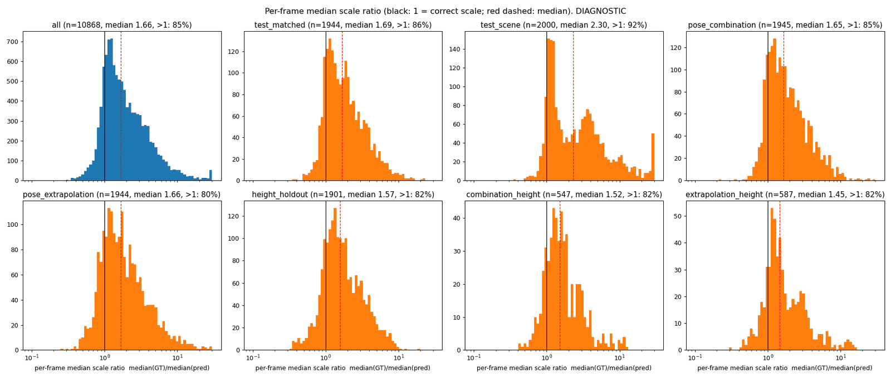
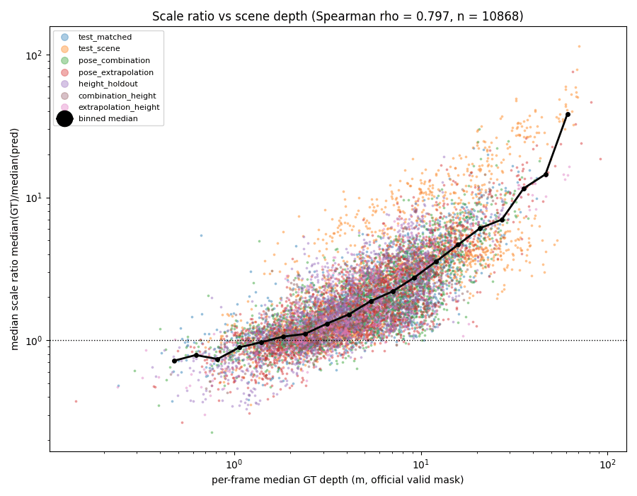
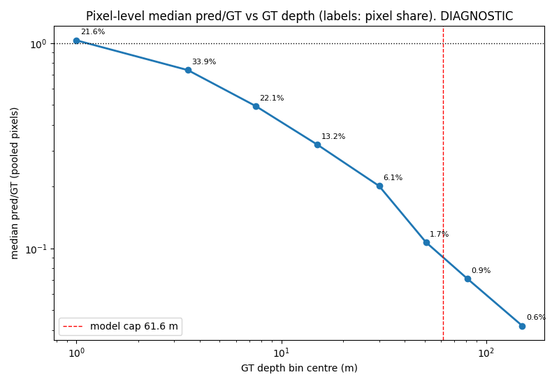
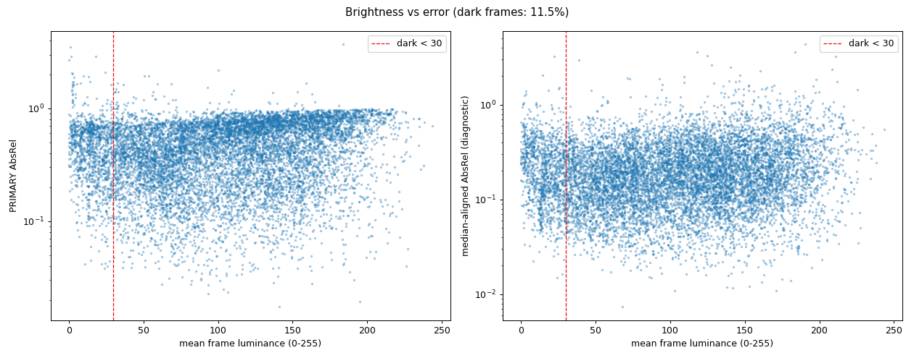
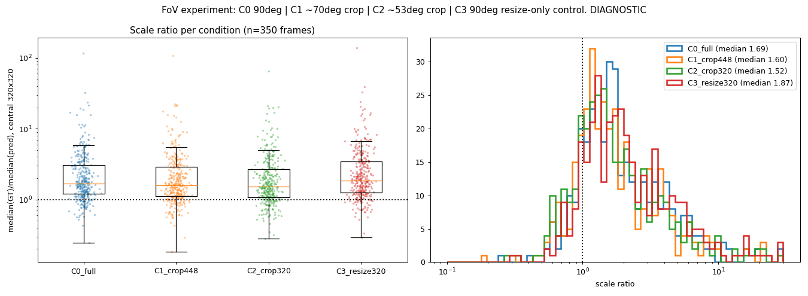
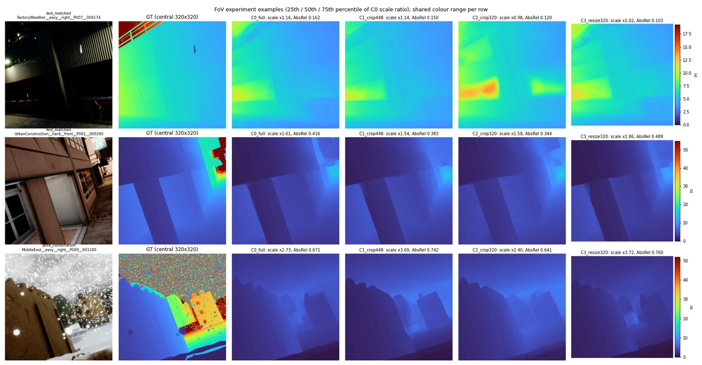
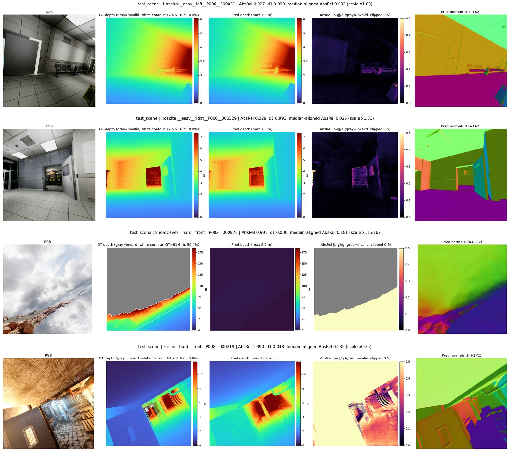
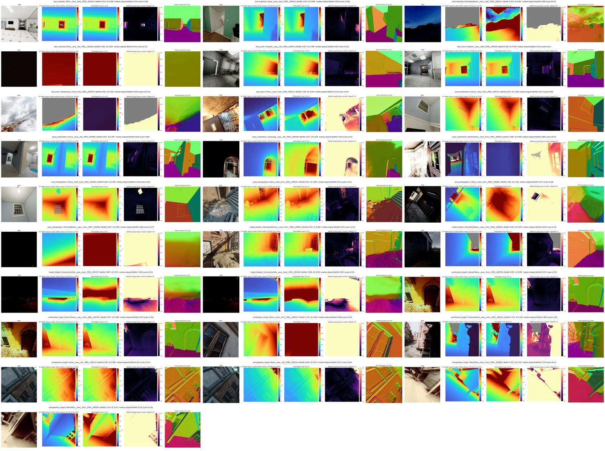
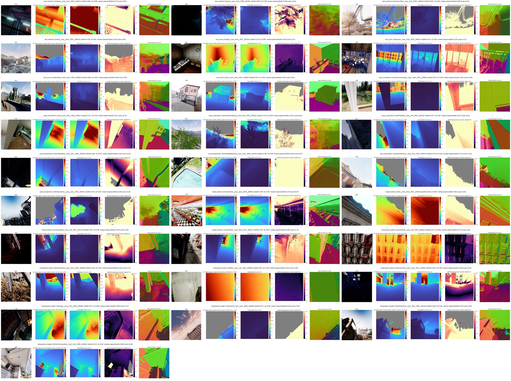

# Zero-shot Metric3D v2-S on the TartanAir v2 test set

<!-- Generated by tartanair_eval/build_report.py from result files; edit tartanair_eval/report_template.md, not this file. -->

All numbers in this report are read from result files by `tartanair_eval/build_report.py`. Tables or rows marked
**(ours)** and everything labelled **DIAGNOSTIC** are our own analyses; the **PRIMARY** numbers are produced by the
dataset's official, unmodified `eval_depth.py`.

## 1. Summary

- **PRIMARY result (official `eval_depth.py`):** over all 10868 test frames, AbsRel 0.4721, d1 0.2539, RMSE 10.975 m (frame-weighted pooled row, ours). Per-subset AbsRel ranges from 0.4341 to 0.5348 (`test_scene`). No frame failed or was unscorable.
- **The dominant error is metric scale, and it is depth-dependent.** The per-frame ratio median(GT)/median(pred) is above 1 on 84.7% of frames (median 1.662, 10th-90th percentile 0.92-5.06). Pooled over pixels, median pred/GT falls monotonically from 1.032 for GT in 0-2 m to 0.042 for GT in 100-200 m: near content is roughly right, far content is strongly range-compressed.
- **Relative structure is much better than metric scale:** per-frame median alignment lowers mean AbsRel from 0.4721 to 0.2336. The per-frame scale ratio correlates with scene depth (Spearman rho = 0.797 vs. per-frame median GT depth).
- **The model's depth cap costs little in relative metrics.** At fx = 320 the pipeline cannot output more than 61.6 m; 1.52% of valid pixels lie beyond it. Excluding them changes AbsRel by -0.0033 and d1 by +0.0008, but RMSE by -3.600 m.
- **Field of view explains only part of the scale error.** Narrowing the FoV from 90° to 53.1° (centre crop, correct intrinsics) lowers the median scale ratio from 1.695 to 1.525; against a resize-only control with the same resampling path it lowers the ratio by a factor 0.845 (67.4% of frames move closer to 1). Even at 53.1° most of the bias remains (80% of C0's median log-ratio), so it is mainly content/domain (far-range compression), not FoV alone.
- **Scene type matters far more than subset, difficulty or pose.** Environment means range from AbsRel 0.142 (CountryHouse) to 0.894 (ShoreCaves); indoor scenes score best and large outdoor scenes worst. Easy vs. hard, camera face, pitch and dark frames change AbsRel little; roll shows a modest increase. Environment explains a much larger share of per-frame AbsRel variance (eta squared 0.472) than any other grouping (at most 0.016).
- **Correctness:** our wrapper reproduces the official Metric3D test pipeline bit for bit (max abs difference 0.0 on KITTI and 0.0 on NYU demo frames, depth and normals); predictions and metrics were re-checked across runs (exact matches).

## 2. Setup

**Model.** Metric3D v2-S: DINOv2-reg ViT-Small encoder + RAFT-style GRU decoder (4 iterations) predicting depth and surface normals. Config `mono/configs/HourglassDecoder/vit.raft5.small.py` (unchanged: input `crop_size` 616x1064, canonical focal length 1000, decoder depth clamp [0.1, 200] in canonical space). Weights `$RCAC_SCRATCH/metric3d/weights/metric_depth_vit_small_800k.pth` (the official `metric_depth_vit_small_800k.pth`), sha256 `b34b2a2be9148054991cef7e417930e1320602ba7bc503b0ee4e7888543728f6`.

**Inference pipeline (official, unmodified).** We call the repo's own `mono/utils/do_test.py` functions (`transform_test_data_scalecano`, `get_prediction`) and replicate the math of `postprocess_per_image` exactly; model building and checkpoint loading mirror `mono/tools/test_scale_cano.py` (DataParallel + `load_ckpt`). Per frame:

1. **Canonical camera transform.** The image is treated as if taken by a camera with focal length 1000: depth labels scale by 1000 / f. The 640x640 image is resized to 616x616 and padded with the ImageNet mean by 224+224 px (left+right) to 616x1064. The combined **label scale factor** is (1000 / 320) x (640 / 616) = **3.247** (`3.2467532467532463`).
2. **Forward pass.** The network predicts canonical depth, clamped to [0.1, 200].
3. **Back to metric.** Remove the padding, bilinearly resize to 640x640, divide by the label scale factor, zero anything outside (0, 300) m.

**The network never sees the intrinsics.** In this code path `cam_model` is passed as `None` and is unused by the model (in both the inference and training trees); intrinsics only enter through the label scale factor in steps 1 and 3. The network must therefore infer canonical depth from the apparent size of things in pixels.

**Test set.** TartanAir v2 test package: 10868 frames, 7 mutually exclusive subsets, 44 environments, 640x640 RGB, planar-Z depth in metres, official valid mask (depth in (0.001, 200] m and not sky). Every frame has the same pinhole intrinsics (fx=320.0, fy=320.0, cx=320.0, cy=320.0; 90° FoV).

| subset | frames |
|---|---|
| test_matched | 1944 |
| test_scene | 2000 |
| pose_combination | 1945 |
| pose_extrapolation | 1944 |
| height_holdout | 1901 |
| combination_height | 547 |
| extrapolation_height | 587 |

Hardware: NVIDIA A100 80GB PCIe (Gilbreth gilbreth-k046). Full-set inference took 1010.6 s (16.8 min; 0.092 s per frame including zip read and save, 0.063 s model time), batch size 1.

## 3. Correctness checks

1. **Wrapper vs. official inference.** `tartanair_eval/check_equivalence.py` runs the unmodified official `do_scalecano_test_with_custom_data` on the repo's demo annotations and captures its final post-processed depth and normals by wrapping (not editing) three functions at runtime, then runs our wrapper on the same images and intrinsics. Max abs difference: KITTI (3 frames) depth 0.0, normals 0.0; NYU (3 frames) depth 0.0, normals 0.0.
2. **Official smoke test on KITTI / NYU demos.** This repo version computes but never prints its metrics (the print block is behind `if False:`), so we read them from the official metric meters via the same harness. They are plausible for a metric-depth model on these demos. The repo's meter reports SILog as a fraction (not x100 as in `eval_depth.py`), and its NYU global-aligned SILog/d2 values are invalid (NaN, > 1) and should be ignored.

| demo | alignment | AbsRel | RMSE | SILog | d1 | d2 | d3 |
|---|---|---|---|---|---|---|---|
| KITTI | metric | 0.0614 | 2.5650 | 0.0305 | 0.9838 | 0.9985 | 0.9997 |
| KITTI | median-aligned | 0.0460 | 2.3857 | 0.0305 | 0.9901 | 0.9986 | 0.9997 |
| KITTI | global-aligned | 0.0484 | 2.2677 | 0.0309 | 0.9903 | 0.9987 | 0.9996 |
| NYU | metric | 0.1002 | 0.4761 | 0.0590 | 0.9065 | 0.9869 | 0.9934 |
| NYU | median-aligned | 0.0683 | 0.3993 | 0.0590 | 0.9438 | 0.9849 | 0.9948 |
| NYU | global-aligned | 0.0668 | 0.3694 | nan | 0.9979 | 1.0256 | 1.0293 |

| demo | pred depth p1 - p99 (m) | GT depth range (m) | per-image median GT/pred |
|---|---|---|---|
| KITTI | 5.15 - 121.14 | 5.13 - 84.89 | 1.013, 1.056, 1.045 |
| NYU | 0.07 - 6.99 | 0.71 - 8.27 | 1.023, 1.020, 1.155 |

3. **Pilot vs. full run.** The 21 Stage-1 pilot frames scored again inside the full official evaluation: max abs difference over all 10 per-frame metrics = 0.0.
4. **Independent recomputation and identity checks.**
   - Prediction files: 10868, one per `frames.tsv` row in every subset, no extras (exact match: yes); 17.8 GB.
   - Official evaluation exit status: 0 (no failures, no unscorable frames).
   - Pooled "all frames (ours)" rows recomputed as the frame-weighted mean of the per-subset official means: max difference 7.1e-15 (PRIMARY), 8.9e-16 (DIAGNOSTIC).
   - Re-running inference for the FoV experiment's full-image condition reproduced the Stage-2 predictions bit for bit (350/350 frames); visualisation re-runs likewise (56/56).

## 4. Evaluation protocol

**PRIMARY (the number to report and compare).** The dataset's `metrics/eval_depth.py`, unmodified, run with `python -B` on predictions saved as float32 640x640 metres. It scores each frame on its own valid mask and averages per subset with equal weight per frame (AbsRel, SqRel, RMSE, RMSElog, log10, SILog, d1-d3, MAE). The script reports per subset only; the **all frames** row is our frame-weighted mean over all scored frames, computed from its per-frame output.

**DIAGNOSTIC (ours; explains the PRIMARY numbers, never replaces them).** All use `eval_depth.py`'s own functions imported by path:
- *Capped mask:* official valid mask AND GT <= cap, to measure what the model's maximum depth costs.
- *Scale ratio:* per frame, median(GT) / median(pred) on the official valid mask (> 1 = prediction too small).
- *Median-aligned AbsRel:* AbsRel after multiplying the prediction by that per-frame ratio (scale-free relative accuracy).

**How the 61.6 m cap follows from the code.** The decoder clamps canonical depth at 200 (`depth_normalize` / `max_value` in the config). Metric depth = canonical depth / label scale factor, so the largest metric depth the pipeline can output at fx = 320, 640x640 is 200 / 3.247 = **61.6 m** (and the smallest is 0.0308 m). The cap depends on the intrinsics and image size (e.g. KITTI's demo frames saturate at 121.1 m).

## 5. Results

### PRIMARY (official `eval_depth.py`)

| subset | frames | unscorable | failures | AbsRel | SqRel | RMSE | RMSElog | SILog | d1 | d2 | d3 | MAE |
|---|---|---|---|---|---|---|---|---|---|---|---|---|
| test_matched | 1944 | 0 | 0 | 0.4429 | 4.759 | 10.382 | 0.8086 | 33.22 | 0.2673 | 0.4354 | 0.5792 | 6.217 |
| test_scene | 2000 | 0 | 0 | 0.5348 | 9.377 | 16.802 | 1.1515 | 34.21 | 0.2463 | 0.3568 | 0.4262 | 11.169 |
| pose_combination | 1945 | 0 | 0 | 0.4461 | 4.880 | 10.508 | 0.8159 | 34.28 | 0.2734 | 0.4441 | 0.5762 | 6.332 |
| pose_extrapolation | 1944 | 0 | 0 | 0.4824 | 5.386 | 10.713 | 0.8848 | 37.90 | 0.2377 | 0.4155 | 0.5548 | 6.728 |
| height_holdout | 1901 | 0 | 0 | 0.4688 | 3.342 | 7.464 | 0.7768 | 31.70 | 0.2501 | 0.4444 | 0.5929 | 4.463 |
| combination_height | 547 | 0 | 0 | 0.4341 | 4.001 | 9.187 | 0.7587 | 34.15 | 0.2482 | 0.4843 | 0.6443 | 5.387 |
| extrapolation_height | 587 | 0 | 0 | 0.4530 | 4.224 | 8.543 | 0.7848 | 34.06 | 0.2418 | 0.4748 | 0.6119 | 5.413 |
| **all frames (ours)** | 10868 | 0 | 0 | 0.4721 | 5.428 | 10.975 | 0.8773 | 34.26 | 0.2539 | 0.4251 | 0.5536 | 6.848 |

### DIAGNOSTIC: capped mask (GT <= 61.6 m)

| subset | frames | unscorable | failures | AbsRel | SqRel | RMSE | RMSElog | SILog | d1 | d2 | d3 | MAE | valid px > cap |
|---|---|---|---|---|---|---|---|---|---|---|---|---|---|
| test_matched | 1944 | 0 | 0 | 0.4392 | 3.606 | 7.044 | 0.7711 | 29.52 | 0.2683 | 0.4371 | 0.5821 | 5.007 | 1.21% |
| test_scene | 2000 | 0 | 0 | 0.5312 | 6.259 | 10.141 | 1.1028 | 29.15 | 0.2466 | 0.3574 | 0.4275 | 7.753 | 3.82% |
| pose_combination | 1945 | 0 | 0 | 0.4423 | 3.702 | 7.182 | 0.7785 | 30.73 | 0.2746 | 0.4461 | 0.5791 | 5.095 | 1.23% |
| pose_extrapolation | 1944 | 0 | 0 | 0.4789 | 4.033 | 7.411 | 0.8460 | 34.43 | 0.2385 | 0.4170 | 0.5573 | 5.335 | 1.10% |
| height_holdout | 1901 | 0 | 0 | 0.4665 | 2.758 | 5.561 | 0.7561 | 29.50 | 0.2508 | 0.4458 | 0.5949 | 3.852 | 0.53% |
| combination_height | 547 | 0 | 0 | 0.4311 | 3.127 | 6.650 | 0.7309 | 31.51 | 0.2490 | 0.4858 | 0.6467 | 4.482 | 0.84% |
| extrapolation_height | 587 | 0 | 0 | 0.4500 | 3.062 | 6.125 | 0.7544 | 31.66 | 0.2425 | 0.4760 | 0.6134 | 4.225 | 0.75% |
| **all frames (ours)** | 10868 | 0 | 0 | 0.4687 | 3.986 | 7.375 | 0.8413 | 30.76 | 0.2547 | 0.4265 | 0.5559 | 5.316 | 1.52% |

Difference DIAGNOSTIC minus PRIMARY:

| subset | Δ AbsRel | Δ d1 | Δ RMSE (m) |
|---|---|---|---|
| test_matched | -0.0037 | +0.0010 | -3.338 |
| test_scene | -0.0036 | +0.0002 | -6.661 |
| pose_combination | -0.0037 | +0.0012 | -3.326 |
| pose_extrapolation | -0.0035 | +0.0007 | -3.303 |
| height_holdout | -0.0022 | +0.0007 | -1.903 |
| combination_height | -0.0030 | +0.0008 | -2.537 |
| extrapolation_height | -0.0029 | +0.0007 | -2.418 |
| **all frames (ours)** | -0.0033 | +0.0008 | -3.600 |

### Scale

| subset | median of per-frame median scale ratio | mean median-aligned AbsRel | PRIMARY AbsRel | median of per-frame median GT depth (m) |
|---|---|---|---|---|
| test_matched | 1.687 | 0.2245 | 0.4429 | 5.21 |
| test_scene | 2.300 | 0.2302 | 0.5348 | 5.18 |
| pose_combination | 1.648 | 0.2380 | 0.4461 | 4.99 |
| pose_extrapolation | 1.661 | 0.2593 | 0.4824 | 4.88 |
| height_holdout | 1.572 | 0.2205 | 0.4688 | 3.91 |
| combination_height | 1.517 | 0.2245 | 0.4341 | 4.45 |
| extrapolation_height | 1.449 | 0.2273 | 0.4530 | 4.29 |
| **all frames (ours)** | 1.662 | 0.2336 | 0.4721 | 4.71 |

## 6. Error analysis (DIAGNOSTIC)

### 6.1 Scale ratio vs. scene depth





The per-frame scale ratio grows with the frame's median GT depth (Spearman rho = 0.797 over all frames). Frames whose median depth is a metre or two have ratios close to 1; frames dominated by tens of metres are under-predicted several-fold.

| group | frames | Spearman rho (scale ratio vs median GT depth) |
|---|---|---|
| all | 10868 | 0.797 |
| test_matched | 1944 | 0.793 |
| test_scene | 2000 | 0.808 |
| pose_combination | 1945 | 0.797 |
| pose_extrapolation | 1944 | 0.817 |
| height_holdout | 1901 | 0.775 |
| combination_height | 547 | 0.722 |
| extrapolation_height | 587 | 0.721 |

### 6.2 Pixel-level error vs. GT depth (all frames pooled, official valid mask)

| GT depth bin (m) | pixel share | AbsRel | median pred/GT | d1 |
|---|---|---|---|---|
| 0-2 | 21.56% | 0.3457 | 1.032 | 0.5244 |
| 2-5 | 33.86% | 0.3248 | 0.739 | 0.3743 |
| 5-10 | 22.08% | 0.4846 | 0.494 | 0.1497 |
| 10-20 | 13.21% | 0.6318 | 0.320 | 0.0417 |
| 20-40 | 6.12% | 0.7600 | 0.202 | 0.0087 |
| 40-61.6 | 1.66% | 0.8486 | 0.107 | 0.0026 |
| 61.6-100 | 0.93% | 0.8839 | 0.071 | 0.0001 |
| 100-200 | 0.59% | 0.9156 | 0.042 | 0.0000 |



55.4% of valid pixels are within 5 m; there the median pred/GT is 1.032 (0-2 m) and 0.739 (2-5 m). It then falls to 0.494 (5-10 m), 0.320 (10-20 m) and down to 0.042 (100-200 m): predictions are range-compressed, increasingly with distance. Bins beyond 61.6 m are additionally limited by the cap. (Bin medians come from a log-ratio histogram with 0.23% resolution.)

### 6.3 Environment, difficulty, camera face, pitch and roll

Environments (44 in total; full table below):

| environment (best 5) | frames | mean AbsRel | mean d1 | median scale ratio | mean median-aligned AbsRel |
|---|---|---|---|---|---|
| CountryHouse | 154 | 0.1424 | 0.8474 | 1.057 | 0.0842 |
| Hospital | 333 | 0.1656 | 0.7260 | 1.142 | 0.0929 |
| Supermarket | 153 | 0.2153 | 0.6124 | 1.156 | 0.1530 |
| AmericanDiner | 266 | 0.2303 | 0.6879 | 0.935 | 0.1545 |
| House | 154 | 0.2364 | 0.6677 | 0.913 | 0.0860 |

| environment (worst 5) | frames | mean AbsRel | mean d1 | median scale ratio | mean median-aligned AbsRel |
|---|---|---|---|---|---|
| Gascola | 199 | 0.7005 | 0.0302 | 3.811 | 0.4045 |
| Downtown | 334 | 0.7267 | 0.0056 | 3.924 | 0.2686 |
| AmusementPark | 156 | 0.7582 | 0.0104 | 5.062 | 0.4716 |
| ForestEnv | 154 | 0.7957 | 0.0141 | 5.841 | 0.5435 |
| ShoreCaves | 333 | 0.8944 | 0.0000 | 10.912 | 0.2895 |

The best environments are indoor (scale ratio near 1, low median-aligned AbsRel); the worst are large outdoor scenes with scale ratios of several times. Environment explains far more of the per-frame AbsRel variance than any other grouping (eta squared 0.472 vs. at most 0.016):

| grouping | groups | eta squared (share of per-frame AbsRel variance) |
|---|---|---|
| environment | 44 | 0.472 |
| subset | 7 | 0.016 |
| difficulty | 2 | 0.000 |
| face | 4 | 0.001 |
| abs. pitch bin | 5 | 0.002 |
| abs. roll bin | 5 | 0.007 |

| difficulty | frames | mean AbsRel | mean d1 | median scale ratio | mean median-aligned AbsRel |
|---|---|---|---|---|---|
| easy | 6526 | 0.4710 | 0.2490 | 1.654 | 0.2309 |
| hard | 4342 | 0.4737 | 0.2612 | 1.680 | 0.2378 |

| face | frames | mean AbsRel | mean d1 | median scale ratio | mean median-aligned AbsRel |
|---|---|---|---|---|---|
| back | 1916 | 0.4862 | 0.2389 | 1.681 | 0.2496 |
| front | 6167 | 0.4713 | 0.2574 | 1.690 | 0.2300 |
| left | 1409 | 0.4610 | 0.2561 | 1.586 | 0.2280 |
| right | 1376 | 0.4673 | 0.2568 | 1.634 | 0.2335 |

| abs. pitch (deg) | frames | mean AbsRel | mean d1 | median scale ratio | mean median-aligned AbsRel |
|---|---|---|---|---|---|
| 0-10 | 4470 | 0.4632 | 0.2728 | 1.611 | 0.2251 |
| 10-20 | 2591 | 0.4822 | 0.2397 | 1.769 | 0.2400 |
| 20-30 | 2451 | 0.4857 | 0.2361 | 1.701 | 0.2422 |
| 30-40 | 896 | 0.4605 | 0.2509 | 1.559 | 0.2384 |
| 40-45 | 460 | 0.4519 | 0.2502 | 1.660 | 0.2262 |

| abs. roll (deg) | frames | mean AbsRel | mean d1 | median scale ratio | mean median-aligned AbsRel |
|---|---|---|---|---|---|
| 0-10 | 4340 | 0.4461 | 0.2888 | 1.558 | 0.2131 |
| 10-20 | 2678 | 0.4792 | 0.2386 | 1.759 | 0.2297 |
| 20-30 | 2404 | 0.4944 | 0.2290 | 1.730 | 0.2529 |
| 30-40 | 929 | 0.4912 | 0.2189 | 1.661 | 0.2688 |
| 40-45 | 517 | 0.5150 | 0.2188 | 1.707 | 0.2742 |

Difficulty (easy 0.471, hard 0.474), face (0.461-0.486) and pitch (0.452-0.486) move mean AbsRel only slightly. With roll, AbsRel rises from 0.446 (|roll| 0-10°) to 0.515 (40-45°) and median-aligned AbsRel rises monotonically from 0.213 to 0.274, i.e. strongly rolled views also hurt relative structure.

<details><summary>All environments, sorted by mean AbsRel</summary>

| environment | frames | mean AbsRel | mean d1 | median scale ratio | mean median-aligned AbsRel |
|---|---|---|---|---|---|
| CountryHouse | 154 | 0.1424 | 0.8474 | 1.057 | 0.0842 |
| Hospital | 333 | 0.1656 | 0.7260 | 1.142 | 0.0929 |
| Supermarket | 153 | 0.2153 | 0.6124 | 1.156 | 0.1530 |
| AmericanDiner | 266 | 0.2303 | 0.6879 | 0.935 | 0.1545 |
| House | 154 | 0.2364 | 0.6677 | 0.913 | 0.0860 |
| Office | 153 | 0.2378 | 0.7030 | 0.994 | 0.1357 |
| RetroOffice | 267 | 0.2567 | 0.6434 | 1.041 | 0.1097 |
| AncientTowns | 453 | 0.2668 | 0.4051 | 1.247 | 0.1312 |
| Rome | 385 | 0.2857 | 0.4706 | 1.041 | 0.1445 |
| OldBrickHouseDay | 168 | 0.3017 | 0.4205 | 1.214 | 0.1470 |
| Restaurant | 333 | 0.3023 | 0.4689 | 1.200 | 0.2394 |
| Sewerage | 260 | 0.3101 | 0.3768 | 1.296 | 0.1629 |
| VictorianStreet | 452 | 0.3476 | 0.2579 | 1.486 | 0.1522 |
| AbandonedFactory | 269 | 0.3709 | 0.2781 | 1.529 | 0.1833 |
| ArchVizTinyHouseDay | 172 | 0.3733 | 0.5143 | 0.885 | 0.2865 |
| AbandonedFactory2 | 156 | 0.3845 | 0.1312 | 1.594 | 0.1502 |
| NordicHarbor | 153 | 0.3933 | 0.2719 | 1.526 | 0.2535 |
| CarWelding | 156 | 0.4064 | 0.1406 | 1.637 | 0.1926 |
| DesertGasStation | 295 | 0.4448 | 0.2045 | 1.592 | 0.2166 |
| UrbanConstruction | 153 | 0.4507 | 0.1307 | 1.834 | 0.1641 |
| CoalMine | 237 | 0.4546 | 0.1280 | 1.817 | 0.1489 |
| OldTownSummer | 243 | 0.4589 | 0.1694 | 1.996 | 0.2844 |
| MiddleEast | 301 | 0.4778 | 0.1582 | 1.759 | 0.2648 |
| Prison | 333 | 0.4809 | 0.2408 | 1.928 | 0.2194 |
| Antiquity3D | 276 | 0.5239 | 0.1078 | 2.101 | 0.2348 |
| HongKong | 206 | 0.5255 | 0.3892 | 0.779 | 0.2252 |
| SeasideTown | 282 | 0.5450 | 0.0781 | 2.148 | 0.2400 |
| Apocalyptic | 405 | 0.5627 | 0.1949 | 2.592 | 0.3720 |
| FactoryWeather | 154 | 0.5628 | 0.1218 | 2.133 | 0.3233 |
| EndofTheWorld | 170 | 0.5688 | 0.0810 | 2.393 | 0.2048 |
| ModularNeighborhood | 153 | 0.5745 | 0.0790 | 2.299 | 0.3323 |
| CyberPunkDowntown | 154 | 0.5978 | 0.0608 | 2.714 | 0.3050 |
| ConstructionSite | 248 | 0.6051 | 0.1872 | 1.769 | 0.3875 |
| IndustrialHangar | 270 | 0.6276 | 0.0303 | 2.807 | 0.2465 |
| OldIndustrialCity | 295 | 0.6344 | 0.0573 | 2.898 | 0.2686 |
| Ruins | 234 | 0.6356 | 0.0381 | 2.702 | 0.2931 |
| CastleFortress | 334 | 0.6380 | 0.0381 | 2.905 | 0.2714 |
| Fantasy | 283 | 0.6639 | 0.0554 | 3.856 | 0.2831 |
| SeasonalForestSpring | 229 | 0.6644 | 0.0433 | 3.110 | 0.3615 |
| Gascola | 199 | 0.7005 | 0.0302 | 3.811 | 0.4045 |
| Downtown | 334 | 0.7267 | 0.0056 | 3.924 | 0.2686 |
| AmusementPark | 156 | 0.7582 | 0.0104 | 5.062 | 0.4716 |
| ForestEnv | 154 | 0.7957 | 0.0141 | 5.841 | 0.5435 |
| ShoreCaves | 333 | 0.8944 | 0.0000 | 10.912 | 0.2895 |

</details>

### 6.4 Brightness

| group | frames | share | mean AbsRel | mean d1 | median scale ratio | mean median-aligned AbsRel |
|---|---|---|---|---|---|---|
| dark (luma < 30) | 1249 | 11.5% | 0.4842 | 0.2467 | 1.481 | 0.2474 |
| rest | 9619 | 88.5% | 0.4705 | 0.2548 | 1.689 | 0.2319 |



Dark frames (mean luminance < 30/255; 11.5% of frames) are only slightly worse than the rest. Across all frames, Spearman rho between luminance and AbsRel is 0.203 (brighter frames slightly *worse*, plausibly because bright frames are more often large outdoor scenes) and 0.094 for median-aligned AbsRel. Darkness is not a major error source here.

### 6.5 Field-of-view experiment

**Question.** Does a narrower field of view bring the scale ratio closer to 1? If so, the scale error is mainly a FoV / apparent-size effect; if not, it is content or domain.

**Design.** 350 frames (50 per subset, seeded, 44 environments). Four conditions, each through the same wrapper with correctly adjusted intrinsics:

- **C0 full**: 640x640, fx = fy = 320, 90° FoV (equals the Stage-2 prediction).
- **C1 crop448**: centre crop 448x448, cx = cy = 224, about 70.0°.
- **C2 crop320**: centre crop 320x320, cx = cy = 160, about 53.1°.
- **C3 resize320** (control): the full image resized to 320x320 (INTER_AREA), fx = fy = 160. Same 90° FoV as C0, but the same down- then up-sampling path as C2. C2 vs. C3 therefore isolates the FoV from resolution and blur.

All conditions are scored on the same pixels: the central 320x320 region of the official valid mask (C0/C1 predictions cropped; C3 prediction upsampled to 640 then cropped). Each condition has its own depth cap because the label scale factor changes with crop size.

| condition | model cap (m) | frames | median scale ratio | median abs(log ratio) | mean AbsRel | mean d1 | mean median-aligned AbsRel | frames closer to 1 than C0 |
|---|---|---|---|---|---|---|---|---|
| C0_full | 61.6 | 350 | 1.695 | 0.548 | 0.4902 | 0.2214 | 0.2541 | - |
| C1_crop448 | 88.0 | 350 | 1.597 | 0.503 | 0.4798 | 0.2526 | 0.2609 | 62.9% |
| C2_crop320 | 123.2 | 350 | 1.525 | 0.491 | 0.4828 | 0.2391 | 0.2705 | 61.4% |
| C3_resize320 | 61.6 | 350 | 1.867 | 0.640 | 0.5185 | 0.1867 | 0.2698 | 26.3% |

Same, restricted to GT <= 61.6 m (removes the effect of the different caps):

| condition | model cap (m) | frames | median scale ratio | median abs(log ratio) | mean AbsRel | mean d1 | mean median-aligned AbsRel | frames closer to 1 than C0 |
|---|---|---|---|---|---|---|---|---|
| C0_full | 61.6 | 350 | 1.696 | 0.546 | 0.4856 | 0.2224 | 0.1865 | - |
| C1_crop448 | 88.0 | 350 | 1.597 | 0.503 | 0.4749 | 0.2556 | 0.1880 | 62.6% |
| C2_crop320 | 123.2 | 350 | 1.520 | 0.490 | 0.4787 | 0.2400 | 0.1985 | 61.1% |
| C3_resize320 | 61.6 | 350 | 1.857 | 0.640 | 0.5139 | 0.1877 | 0.1967 | 26.3% |

Paired comparisons on the same frames (median ratio factor A/B < 1 means the scale ratio got smaller in A, i.e. A's prediction is larger; since most ratios are above 1 this usually means closer to the GT scale, which the 'closer to 1' column counts directly; CI by bootstrap over frames):

| A | B | frames | A closer to 1 than B | median ratio factor A/B | 95% CI of median Δlog (A-B) |
|---|---|---|---|---|---|
| C1_crop448 | C0_full | 350 | 62.9% | 0.935 | -0.084 to -0.045 |
| C2_crop320 | C0_full | 350 | 61.4% | 0.915 | -0.116 to -0.055 |
| C3_resize320 | C0_full | 350 | 26.3% | 1.080 | 0.061 to 0.095 |
| C2_crop320 | C3_resize320 | 350 | 67.4% | 0.845 | -0.200 to -0.136 |

Per-subset median scale ratio:

| subset | frames | C0_full | C1_crop448 | C2_crop320 | C3_resize320 |
|---|---|---|---|---|---|
| test_matched | 50 | 1.698 | 1.466 | 1.493 | 1.707 |
| test_scene | 50 | 2.096 | 2.087 | 2.202 | 2.557 |
| pose_combination | 50 | 1.788 | 1.737 | 1.674 | 1.953 |
| pose_extrapolation | 50 | 1.805 | 1.647 | 1.685 | 1.939 |
| height_holdout | 50 | 1.572 | 1.447 | 1.313 | 1.636 |
| combination_height | 50 | 1.663 | 1.622 | 1.490 | 1.840 |
| extrapolation_height | 50 | 1.774 | 1.577 | 1.627 | 2.210 |





**Answer: partially.** Narrowing the FoV moves the ratio toward 1 consistently (C1 and C2 vs. C0: factors 0.935 and 0.915; 62.9% / 61.4% of frames closer to 1; 95% CIs exclude zero). Against the resolution-matched control the FoV effect is larger (C2 vs. C3: factor 0.845, 67.4% of frames closer), because the down/up-sampling path on its own makes the ratio worse (C3 vs. C0: factor 1.080). The capped variant gives the same picture, so the per-condition cap is not the driver. But even at 53.1° the median ratio is still 1.525, so the FoV accounts for a minority of the bias; most of it is the depth-dependent range compression seen in 6.1-6.2, i.e. content/domain. Mean AbsRel improves only slightly (C0 0.4902, C2 0.4828), and the effect is not uniform across subsets (e.g. `test_scene` does not improve).

## 7. Qualitative examples

Each figure row: RGB | GT depth (gray = invalid; white contour = GT beyond 61.6 m) | predicted depth (same colour range as GT) | AbsRel map (gray = invalid) | predicted normals. Titles give subset, frame key, AbsRel, d1 and median-aligned AbsRel.

Best 2 and worst 2 frames of `test_scene` by PRIMARY AbsRel (frames with >= 20% valid pixels):



Best 2 / worst 2 frames of every subset (4 per subset, row-major):



Random frames (4 per subset from distinct environments, seed 0):



Typical good cases are indoor rooms and corridors (prediction close to GT in absolute scale). Typical failures are open outdoor scenes where the prediction stays within a few metres to a few tens of metres while GT extends far beyond, and strongly rolled views. Some worst cases are over-estimates (scale ratio < 1).

## 8. Implications for fine-tuning (observations, not decisions)

- **Scale bias.** Zero-shot v2-S under-predicts TartanAir depth (median scale ratio 1.662), and the bias grows with distance (median pred/GT 1.032 at 0-2 m to 0.042 at 100-200 m). Fine-tuning has to correct a depth-dependent range compression, not just a single global scale factor.
- **Canonical clamp.** Under the same canonical transform as at inference (f = 320 -> 1000, 640 -> 616), canonical depth = GT x 3.247. With the decoder clamp at 200, GT beyond 61.6 m (1.52% of valid test pixels; the valid mask itself reaches 200 m) would be clipped in training as well, unless `depth_normalize` / `max_value` is raised or the training resize changes the factor.
- **Padding.** Square 640x640 frames resized to 616x616 and padded into the 616x1064 input leave 42.1% of the input as padding. A square or differently shaped training crop could use that compute for image content.
- **Will the subsets discriminate?** Zero-shot, the subsets differ little relative to the environment spread: per-subset AbsRel 0.4341-0.5348; `test_scene` (unseen environments; the largest share of valid pixels beyond the cap, 3.82% vs. at most 1.23% elsewhere) separates clearly, and `pose_extrapolation` sits above `test_matched` (`test_scene` 0.522-0.547, `pose_extrapolation` 0.471-0.494, `test_matched` 0.432-0.454). The bootstrap CIs below resample frames and ignore correlation within trajectories and environments, so they are optimistic. Whether the pose/height subsets separate after fine-tuning cannot be judged from zero-shot results; with the domain gap removed, the pose and height effects may become more visible, or remain small.

| subset | frames | mean AbsRel | bootstrap 95% CI (frames resampled) |
|---|---|---|---|
| test_matched | 1944 | 0.4429 | 0.4321 - 0.4539 |
| test_scene | 2000 | 0.5348 | 0.5217 - 0.5473 |
| pose_combination | 1945 | 0.4461 | 0.4351 - 0.4579 |
| pose_extrapolation | 1944 | 0.4824 | 0.4713 - 0.4939 |
| height_holdout | 1901 | 0.4688 | 0.4563 - 0.4809 |
| combination_height | 547 | 0.4341 | 0.4152 - 0.4535 |
| extrapolation_height | 587 | 0.4530 | 0.4334 - 0.4726 |

## 9. Limitations and open questions

- Zero-shot v2-S only; larger v2 models (L, giant2) were not evaluated.
- DIAGNOSTIC analyses are ours. Bootstrap CIs treat frames as independent, which they are not (shared trajectories and environments).
- The FoV experiment uses 350 frames and compares central crops; cropping changes image content as well as FoV, and the depth cap differs per condition (the capped variant controls for the latter).
- Brightness and roll effects are correlational and may be confounded with scene type.
- Some GT depth maps contain rendered weather particles (e.g. falling snow in `MiddleEast`) inside the valid mask (visible in the FoV examples); we did not quantify how often this happens.
- Pixel-bin medians come from a histogram (0.23% resolution).
- Not verified: the sha256 of the seven test zips (only `frames.tsv` and `eval_depth.py` were checked against the dataset README).
- Open: why the model compresses far range on TartanAir; how much is synthetic-domain appearance vs. the 90° FoV vs. scene layout (the FoV experiment bounds the FoV share only for central crops).

## 10. Reproduction

Base upstream commit `eb5b6fa` (`ORIGINAL_COMMIT.txt`); work on branch `gilbreth-run`. Environment and node rules are in the repo's `CLAUDE.md`. Outputs live under `$RCAC_SCRATCH/metric3d/outputs/zeroshot_v2s` (scratch).

```bash
cd ~/MMDE/metric3d-v2
OUT=$RCAC_SCRATCH/metric3d/outputs/zeroshot_v2s; F=$OUT/full; S3=$OUT/stage3; T=/depot/chan129/data/TartanAir_v2/tartanair_v2_test
# Stage 1: official smoke test, equivalence, pilot
python -B mono/tools/test_scale_cano.py mono/configs/HourglassDecoder/vit.raft5.small.py --load-from $RCAC_SCRATCH/metric3d/weights/metric_depth_vit_small_800k.pth \
    --test_data_path ./data/kitti_demo/test_annotations.json --launcher None --show-dir $OUT/stage1/smoke/kitti
python -B tartanair_eval/check_equivalence.py --annos data/kitti_demo/test_annotations.json \
    --show-dir $OUT/stage1/equiv/kitti_official --out $OUT/stage1/equiv/kitti_equivalence.json    # same for nyu
python -B tartanair_eval/select_keys.py --per-subset 3 --out $OUT/stage1/pilot/pilot_keys.txt
python -B tartanair_eval/infer_tartanair.py --keys-file $OUT/stage1/pilot/pilot_keys.txt --out-dir $OUT/stage1/pilot
python -B tartanair_eval/score_pilot.py --keys-file $OUT/stage1/pilot/pilot_keys.txt --run-dir $OUT/stage1/pilot
# Stage 2: full inference, PRIMARY and DIAGNOSTIC metrics, visuals
python -B tartanair_eval/infer_tartanair.py --out-dir $F --skip-existing --no-normals
python -B $T/metrics/eval_depth.py --data $T --pred $F/pred --out $F/eval_official --per-frame
python -B tartanair_eval/eval_capped.py --pred $F/pred --out $F/eval_capped --official-dir $F/eval_official
python -B tartanair_eval/select_keys.py --per-subset 4 --seed 0 --out $F/vis_frames_keys.txt
python -B tartanair_eval/infer_tartanair.py --keys-file $F/vis_frames_keys.txt --out-dir $F/vis_frames
python -B tartanair_eval/score_pilot.py --keys-file $F/vis_frames_keys.txt --run-dir $F/vis_frames --vis-dir $F/vis
# Stage 3: analysis, FoV experiment, extremes, report
python -B tartanair_eval/analyze_full.py --run-dir $F --out $S3/analysis --extremes-out $S3/extremes_keys.txt
python -B tartanair_eval/select_keys.py --per-subset 50 --seed 1 --out $S3/fov/fov_keys.txt
python -B tartanair_eval/fov_experiment.py --keys-file $S3/fov/fov_keys.txt --run-dir $F --out $S3/fov --fig $S3/vis/fov_examples.png
python -B tartanair_eval/infer_tartanair.py --keys-file $S3/extremes_keys.txt --out-dir $S3/vis_frames
python -B tartanair_eval/score_pilot.py --keys-file $S3/extremes_keys.txt --run-dir $S3/vis_frames --vis-dir $S3/vis --sheet-prefix sheet_extremes_
python -B tartanair_eval/build_report.py
```

Result files: PRIMARY `$F/eval_official/`, DIAGNOSTIC `$F/eval_capped/` (incl. `all_frames_ours.json`), analysis `$S3/analysis/`, FoV `$S3/fov/`, figures `$F/vis/`, `$S3/vis/`.

Commits (code under `tartanair_eval/`, after the upstream base), plus the commit that adds this report:

- `2c8cd89` Add TartanAir v2 zero-shot inference wrapper and equivalence harness
- `a74fd9e` Add TartanAir pilot key selection and scoring/visualisation
- `72c92ed` infer_tartanair: add --no-normals flag (default unchanged)
- `749c442` select_keys: seeded distinct-environment mode; score_pilot: --vis-dir
- `4eaf1e5` Add eval_capped.py: diagnostic metrics with mask restricted to GT <= cap
- `275ffe5` Add analyze_full.py: diagnostic error breakdowns of the full zero-shot run
- `2d2bbc8` Add fov_experiment.py: diagnostic field-of-view experiment
- `47acb34` score_pilot: add --sheet-prefix for contact sheet names (default unchanged)
- `c3d8dd2` Add report builder: README generated from result files
